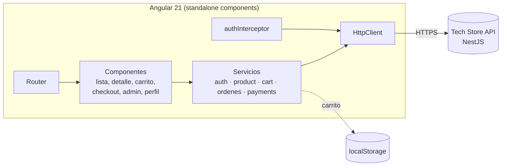

# 🛒 Tech Store - Frontend

Una aplicación Single Page Application (SPA) para un e-commerce de tecnología, construida con Angular y estilizada con Tailwind CSS. Este proyecto es la interfaz de usuario para la Tech Store API.

## ✨ Características Principales

- **🛍️ Catálogo Dinámico:** Visualización de productos filtrados por categoría.
- **🛒 Carrito de Compras:** Gestión del estado del carrito en tiempo real (añadir, quitar y vaciar; se conserva en `localStorage`).
- **🔐 Autenticación JWT:** Registro e inicio de sesión seguros.
- **🛡️ Roles de Usuario:**
  - **Cliente:** Acceso a historial de compras y gestión de datos de envío.
  - **Administrador:** Panel de control (Dashboard) para gestionar productos, categorías y actualizar el estado de las órdenes.
- **💳 Checkout:** crea la orden en la API y genera la preferencia de pago de Mercado Pago.
- **📱 Diseño Responsivo:** Interfaz adaptada a dispositivos móviles y escritorio usando Tailwind CSS.

## 🏗️ Arquitectura

- **Servicios tipados** (`src/app/interfaces/models.ts`) que reflejan el esquema de la API.
- **Interceptor JWT** que solo adjunta el token a peticiones hacia el propio backend.
- **Animaciones en CSS puro** (sin librerías) y respeto de `prefers-reduced-motion`; íconos con `lucide-angular`.

## 🚀 Instalación y Uso

1. Clonar el repositorio:
git clone https://github.com/lauJofre04/ecommerce-frontend.git

2. Instalar las dependencias:
npm install

3. Ejecutar el servidor de desarrollo:
ng serve

4. Abrir el navegador en https://ecommerce-frontend-proyecto.vercel.app/

## 🧑‍💻 Autor
**Lautaro Jofré** - *Full-Stack Developer* - [www.linkedin.com/in/lautaro-jofre]
